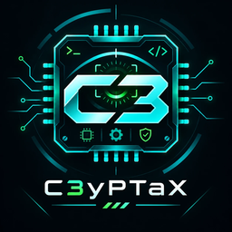

<p align="center">
  
</p>

# C3yPTaX Design System

Die gemeinsame Designgrundlage aller C3yPTaX-Projekte: Farben, Schrift, Abstände, Bewegung, Komponentenregeln und Branding. Technologieunabhängig, damit PowerShell- und WinForms-Anwendungen genauso aussehen wie Weboberflächen.

**Dunkel, modern, technisch, minimalistisch, professionell.** Das Logo darf auffallen, die Oberfläche hält sich zurück.

## Vorschau

[`examples/preview.html`](examples/preview.html) im Browser öffnen. Keine Installation nötig. Die Vorschau zeigt eine realistische Verwaltungsansicht, alle Komponenten, die Farbpalette und die Animationen zum Ausprobieren.

## Aufbau

```
assets/
  originals/     Gelieferte Grafiken, unverändert, mit Prüfsummen
  logo/          Hauptlogo mit Schriftzug als PNG
  mark/          Kompaktlogo ohne Schrift
  icon/          Programmicon als ICO und PNG
  profile/       Profilbild
  wallpaper/     Wallpaper in Full HD, WQHD und 4K, mit und ohne Schriftzug
  product-icon/  Vorlage für Produkt-Icons
tokens/
  tokens.json    Einzige Quelle aller Designwerte (W3C Design Tokens)
  c3.css         Generiert: CSS-Variablen
  c3-theme.ps1   Generiert: PowerShell-Hashtable für WinForms
guidelines/      Branding, Sprache, Bewegung, Umsetzung pro Plattform
components/      Spezifikationen der Bedienelemente
examples/        Designvorschau, CSS-Referenzkomponenten, WinForms-Beispiel
scripts/         Erzeugen von Tokens und Assets, Qualitätsprüfung
DESIGN.md        Designsprache und verbindliche Regeln
AGENTS.md        Anweisungen für Claude und andere KI-Werkzeuge
```

## Verwendung

### In einem HTML-Projekt

`tokens/c3.css` ins Projekt kopieren und einbinden. Optional `examples/c3-ui.css` als Startpunkt für Komponenten.

```html
<link rel="stylesheet" href="c3.css">
<style>
  .panel { background: var(--c3-color-surface-card); border-radius: var(--c3-radius-lg); }
</style>
```

### In PowerShell und WinForms

`tokens/c3-theme.ps1` und `assets/icon/c3yptax.ico` ins Projekt kopieren.

```powershell
. "$PSScriptRoot\c3-theme.ps1"
$form.BackColor = $C3.Color.Bg.Canvas
$form.Icon = New-Object System.Drawing.Icon("$PSScriptRoot\Resources\c3yptax.ico")
```

Ein lauffähiges Beispiel mit animierten Buttons steht in [`examples/winforms-demo.ps1`](examples/winforms-demo.ps1).

### In anderen Technologien

`tokens/tokens.json` mit einem JSON-Parser lesen oder mit Style Dictionary in das passende Format umwandeln. Hinweise in [guidelines/platforms.md](guidelines/platforms.md).

### In Claude-Sessions

Das Repository als Referenz angeben, zum Beispiel:

> Gestalte die Oberfläche nach dem C3yPTaX Design System (github.com/C3yPTaX/C3-Design-System). Lies zuerst AGENTS.md.

Claude und andere Werkzeuge finden in [AGENTS.md](AGENTS.md) die verbindlichen Regeln und die Reihenfolge, in der die Dateien gelesen werden.

## Werte ändern

1. `tokens/tokens.json` bearbeiten.
2. `python scripts/build-tokens.py` ausführen.
3. `python scripts/check.py` ausführen. Prüft Kontraste, Sprachregeln, Originale und ob alles generiert ist.

Neue Grafiken kommen nach `assets/originals/`, danach `python scripts/build-assets.py` (benötigt Pillow) und die Prüfsumme in `SHA256SUMS` ergänzen.

Die Wallpaper erzeugt `python scripts/build-wallpapers.py` (benötigt Pillow und NumPy). Der Lauf dauert ein bis zwei Minuten.

Das Programmicon eines Produkts erzeugt `python scripts/build-product-icon.py <zeichen.svg> <zielordner>` (benötigt Pillow und resvg-py). Regeln für das Zeichen in [guidelines/branding.md](guidelines/branding.md).

Die Prüfung läuft auch automatisch bei jedem Push über GitHub Actions.

## Dokumentation

- [DESIGN.md](DESIGN.md): Haltung, Farbe, Typografie, Raster, Form, Zustände
- [guidelines/branding.md](guidelines/branding.md): Logos, Icons, Wallpaper
- [guidelines/writing.md](guidelines/writing.md): Sprache und Texte
- [guidelines/motion.md](guidelines/motion.md): Bewegung und Animation
- [guidelines/platforms.md](guidelines/platforms.md): HTML, WinForms, andere Frameworks
- [components/](components/): Buttons, Formulare, Container, Navigation, Rückmeldung, Daten

## Marke

`C3yPTaX` ist die projektübergreifende Entwicklermarke. Einzelne Produkte nutzen dieses Design-System, sind aber nicht Teil davon. Logos und Grafiken in `assets/` sind Markenzeichen von C3yPTaX und nicht zur Verwendung in fremden Projekten bestimmt.
